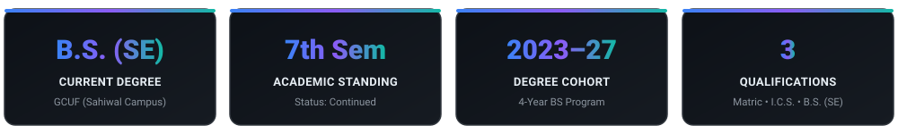
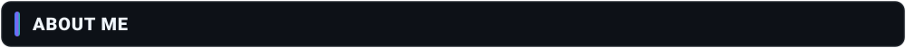
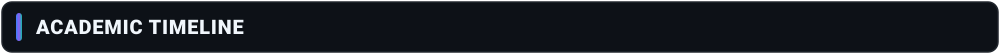

  <!-- Animated Custom Banner -->
  

    

  <!-- Short Summary (Refined directly from CV Career Objective) -->
  

    <strong>BS Software Engineering Student (7th Semester) at GCUF Sahiwal Campus</strong> 
    Seeking to join a dynamic and progressive organization offering opportunities for diversified experience, continuous professional growth, and impact-driven individual contribution toward organizational goals.
  

  <!-- Public Contact & Profile Badges -->
  

    
    
    
    
  

   

  <!-- Real-Data Highlights Card -->
  

 

 

<!-- ==================== ABOUT ME ==================== -->

- **Current Academic Standing:** Pursuing a **Bachelor of Science in Software Engineering (B.S. SE)** at **Government College University Faisalabad (GCUF), Sahiwal Campus** (`2023–2027`), currently in my **7th Semester**.
- **Foundation in Computing:** Completed **Intermediate in Computer Science (I.C.S.)** in `2023` and **Matriculation** in `2021` under BISE Sahiwal.
- **Career Objective:** Looking to begin my professional software engineering journey with a progressive organization where advancement is built on the strength of individual contributions and continuous technical growth.
- **Status:** Fresh candidate open to internships, entry-level software engineering roles, and collaborative academic/industry projects.

 

 

<!-- ==================== ACADEMIC & CAREER TIMELINE ==================== -->

  

 

 

<!-- ==================== EDUCATION ==================== -->

| Degree / Certificate | Period | Institution / Board | Status |
| :--- | :---: | :--- | :---: |
| **B.S. in Software Engineering (SE)** | `2023 – 2027` | **GCUF (Sahiwal Campus)** | Continued (7th Semester) |
| **I.C.S. (Intermediate in Computer Science)** | `2023` | **BISE Sahiwal** | Completed |
| **Matriculation** | `2021` | **BISE Sahiwal** | Completed |

 

 

<!-- ==================== GITHUB STATS ==================== -->

  
  

 

 

<!-- ==================== LET'S CONNECT ==================== -->

  
I am actively looking for entry-level software engineering opportunities, internships, and collaborative projects. Feel free to connect with me on LinkedIn or reach out via email:

  

    
    
    
  

   
  
  Designed for <strong>Muhammad Ajmal Khan</strong> • Sahiwal, Punjab, Pakistan

